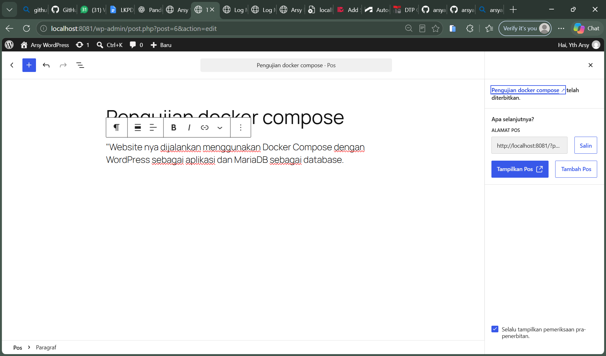

# Docker Compose - WordPress dan MariaDB

**Nama:** Arsy Alvaro Putra  
**Kelas:** XI TJAT-5  
**Nomor Absen:05**  
**Sekolah:** SMK Telkom Sidoarjo

## 1. Deskripsi Project

Project ini merupakan implementasi Docker Compose untuk menjalankan aplikasi WordPress yang terhubung dengan database MariaDB.

Docker Compose digunakan untuk mengelola beberapa container sekaligus sehingga WordPress dan MariaDB dapat berjalan dalam satu project.

Project ini menggunakan dua layanan utama, yaitu WordPress sebagai aplikasi website dan MariaDB sebagai database untuk menyimpan data.

## 2. Teknologi yang Digunakan

- Docker Desktop
- Docker Compose
- WordPress
- MariaDB
- Visual Studio Code

## 3. Struktur Folder

```text
wordpress-compose-arsy/
├── compose.yaml
├── .env
├── .env.example
├── .gitignore
├── README.md
└── bukti-running/
    ├── docker-ps.png
    ├── wordpress-browser.png
    ├── artikel-uji.png
    └── data-persistensi.png
```

## 4. Cara Menjalankan Project

### Persiapan

Pastikan Docker Desktop sudah berjalan dan Docker Compose sudah tersedia.

### Langkah menjalankan

1. Clone repository atau buka folder project.
2. Buat file `.env` berdasarkan `.env.example`.
3. Sesuaikan nilai konfigurasi database pada `.env`.
4. Buka terminal di folder project.
5. Periksa konfigurasi dengan perintah:

```bash
docker compose config
```

6. Jalankan container:

```bash
docker compose up -d
```

7. Periksa status container:

```bash
docker compose ps
```

8. Buka WordPress melalui browser:

http://localhost:8080

9. Selesaikan instalasi WordPress dan buat artikel pengujian.

## 5. Perintah Docker Compose

| Perintah | Fungsi |
|---|---|
| `docker compose config` | Memeriksa konfigurasi |
| `docker compose up -d` | Menjalankan container |
| `docker compose ps` | Melihat status container |
| `docker compose logs wordpress` | Melihat log WordPress |
| `docker compose down` | Menghentikan dan menghapus container |
| `docker compose down` lalu `docker compose up -d` | Menguji persistensi data |

## 6. Jawaban Tugas Eksplorasi

### 1. Apa tujuan Docker Compose dan mengapa WordPress membutuhkan database terpisah?

Docker Compose digunakan untuk menjalankan dan mengatur beberapa container dalam satu project. WordPress membutuhkan database terpisah karena data seperti artikel, akun pengguna, komentar, dan pengaturan website harus disimpan secara terstruktur.

### 2. Jelaskan fungsi service db dan service wordpress!

Service db berfungsi menjalankan MariaDB sebagai tempat penyimpanan data WordPress. Service wordpress berfungsi menjalankan aplikasi WordPress yang digunakan untuk membuat dan mengelola website.

### 3. Jelaskan arti image, container_name, restart, ports, environment, depends_on, dan volumes!

- Image: template yang digunakan untuk membuat container.
- Container_name: nama khusus untuk container.
- Restart: mengatur kebijakan container ketika berhenti.
- Ports: menghubungkan port komputer dengan port container.
- Environment: mengatur variabel konfigurasi di dalam container.
- Depends_on: mengatur ketergantungan antar layanan.
- Volumes: menyimpan data agar tetap tersedia meskipun container dihentikan atau dibuat ulang.

### 4. Mengapa WORDPRESS_DB_HOST menggunakan db:3306, bukan localhost:3306?

Karena WordPress dan MariaDB berjalan di container yang berbeda. Nama db merupakan nama service database yang dapat dikenali melalui jaringan internal Docker Compose. Port 3306 merupakan port MariaDB.

### 5. Jelaskan perbedaan .env, .env.example, dan .gitignore!

File .env digunakan untuk menyimpan konfigurasi dan password database yang sebenarnya. File .env.example digunakan sebagai contoh konfigurasi tanpa password asli. Sedangkan .gitignore digunakan untuk menentukan file yang tidak boleh dimasukkan ke repository GitHub.

### 6. Apa yang dibuktikan oleh percobaan docker compose down lalu docker compose up -d?

Percobaan tersebut digunakan untuk membuktikan bahwa data WordPress tetap tersimpan meskipun container dihentikan dan dijalankan kembali. Hal ini dapat terjadi karena data disimpan menggunakan Docker Volume.

### 7. Pilih satu masalah yang ditemui selama setup!

Masalah yang saya temui: (Isi sesuai masalah yang benar-benar kamu alami).

Penyebab: (Jelaskan penyebab masalah tersebut).

Langkah perbaikan: (Jelaskan cara mengatasinya).

Hasil: (Jelaskan apakah project berhasil berjalan setelah diperbaiki).

### 8. Jelaskan satu modifikasi yang dilakukan sendiri!

Saya melakukan modifikasi pada nama container menjadi arsy-wordpress-app dan arsy-wordpress-db. Saya juga menggunakan port 8080 agar WordPress dapat diakses melalui http://localhost:8080.

Modifikasi ini dilakukan agar nama container lebih mudah dikenali dan akses website tidak menggunakan port default 80 pada komputer.

## 7. Bukti Hasil Running

### A. Status Container


Menampilkan status container WordPress dan MariaDB yang sedang berjalan.

### B. Tampilan WordPress



Menampilkan halaman WordPress yang berhasil diakses melalui browser.

### C. Artikel Pengujian


Menampilkan artikel pengujian yang berhasil dibuat pada WordPress.

### D. Pengujian Persistensi Data


Menunjukkan bahwa artikel tetap tersedia setelah container dihentikan dan dijalankan kembali.

## 8. Kesimpulan

Dari project ini, saya memahami bahwa Docker Compose dapat digunakan untuk menjalankan beberapa layanan dalam satu project. Saya juga memahami penggunaan container, environment variable, jaringan internal, serta volume untuk menjaga data tetap tersimpan.

Project ini berhasil dijalankan setelah konfigurasi WordPress dan MariaDB disiapkan dengan benar.

## 9. Repository GitHub

Tautan Repository: (Masukkan URL repository GitHub kamu)

---

**Project Individu - Docker Compose WordPress dan MariaDB**  
SMK Telkom Sidoarjo
